<p align="center">
  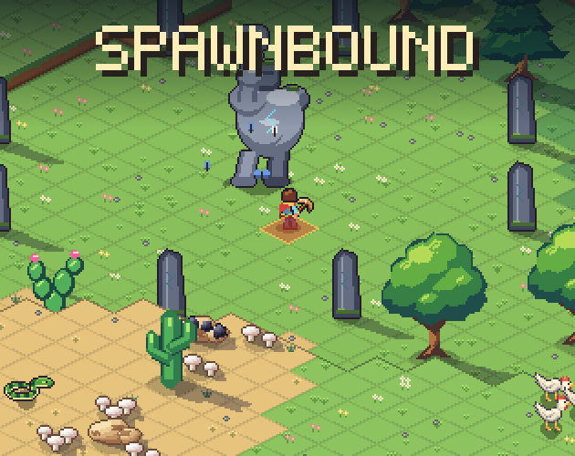
</p>

<h3 align="center">Sobreviva, construa e atravesse o mar numa ilha que nunca se repete.</h3>

<p align="center">
  Jogo de exploração e sobrevivência em pixel art isométrica, feito em Python com o Power PPlay.
</p>

<p align="center">
  <strong><a href="https://jotave-uff.itch.io/spawnbound">Baixar o jogo no itch.io</a></strong> ·
  <a href="https://youtu.be/g-T5OaWJfEE">Assistir ao teaser</a> ·
  <a href="https://github.com/jotave-br/SpawnBound-final">Projeto completo no GitHub</a>
</p>

<p align="center">
  <a href="#como-jogar">Como jogar</a> ·
  <a href="#o-que-dá-para-fazer">O que dá para fazer</a> ·
  <a href="#um-mundo-diferente-a-cada-seed">Mundo gerado por seed</a> ·
  <a href="#documentação">Documentação</a> ·
  <a href="#autores-e-créditos">Créditos</a>
</p>

---

## Sobre o jogo

Você desperta sozinho numa ilha, com quatro ferramentas de madeira e uma casa vazia. Ninguém explica o que aconteceu. Um moinho em ruínas, um cais quebrado e uma horta abandonada mostram que alguém viveu ali antes.

Para sobreviver, você corta árvores, quebra pedras, desce à mina atrás de minério, fabrica ferramentas melhores, cozinha, planta e pesca. À noite, aparecem esqueletos arqueiros e aranhas gigantes. Para seguir em frente, você conserta o cais, navega até a ilha vizinha e enfrenta o **Guardião de Pedra**.

Cada ilha nasce de uma *seed*. A mesma seed sempre gera a mesma ilha, e uma seed nova gera outra, com relevo, rios, lagos, florestas e desertos diferentes.

<p align="center">
  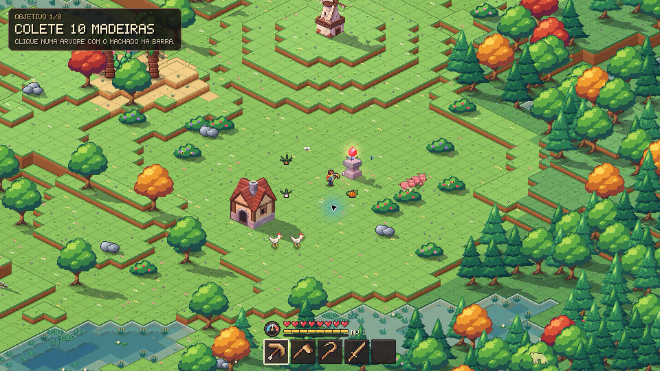
</p>

## Como jogar

<p align="center">
  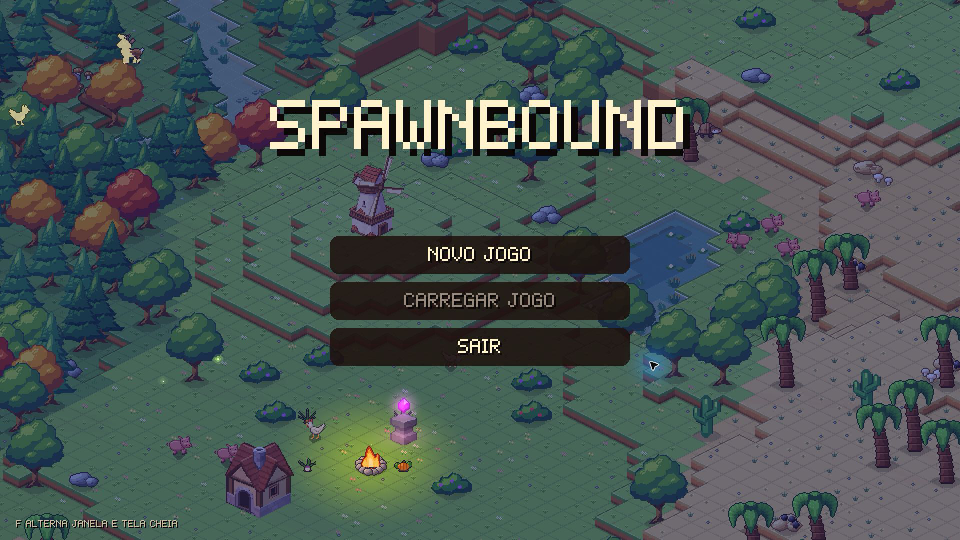
</p>

### No Windows, sem instalar nada

1. Baixe `SpawnBound-windows.zip` na [página do SpawnBound no itch.io](https://jotave-uff.itch.io/spawnbound) e escolha **Extrair tudo**.
2. Abra a pasta `SpawnBound` e execute `SpawnBound.exe`. Deixe a pasta `_internal` junto dele, porque o Python já vem dentro dela.
3. Se aparecer **O Windows protegeu o computador**, escolha **Mais informações** e **Executar assim mesmo**.

### Pelo código

O projeto foi testado no Windows com Python 3.12 e 3.13. Na pasta que contém `main.py`, instale a dependência e inicie o jogo:

```powershell
python -m pip install -r requirements.txt
python main.py
```

Depois da instalação, você também pode abrir o jogo com `RUN_GAME_WITH_ART.bat`.

**macOS:** o repositório inclui `RUN_GAME_MAC.sh` para rodar pelo código. Com Python 3 instalado (o script exige pelo menos 3.10), execute `sh RUN_GAME_MAC.sh` no Terminal. Ele cria a `.venv`, instala o pygame-ce e inicia o jogo. A entrega empacotada é para Windows. A execução em um Mac físico ainda precisa ser confirmada.

O jogo guarda até três partidas em `saves/`. Pelo código, a pasta fica junto de `main.py`. Na versão para Windows, fica junto de `SpawnBound.exe`. Para salvar, aperte **Esc** e escolha **Salvar jogo**.

### Controles

| Comando | Ação |
| --- | --- |
| Clique esquerdo | Andar, coletar, atacar e colocar móveis. Segurar continua coletando |
| Clique direito | Comer, arar com a foice, plantar e colher |
| Roda do mouse ou 1 a 5 | Escolher o item da barra. Também gira o móvel antes de colocá-lo |
| Espaço | Pular |
| E | Interagir com portas, baús, estações, pedras de viagem e o cais |
| I ou Tab / M | Mochila e fabricação / mapa da ilha |
| Q / R | Comer / dormir perto da cama ou da fogueira |
| U | Melhorar a ferramenta selecionada |
| Esc / F | Pausa, com a lista de controles / tela cheia ou janela |

**Pesca:** segure o clique sobre a água e solte para lançar. Clique quando aparecer o **!**. No minigame, segure para subir a barra verde e solte para descer, mantendo o peixe dentro dela.

## O que dá para fazer

**Coletar, fabricar e restaurar.** Cada golpe faz a árvore ou a pedra tremer e soltar lascas. Com o material, você fabrica bancada, fornalha, cama, baú, tochas, composteira e fogueira. As ferramentas evoluem de madeira para pedra, cobre e quartzo. Consertar o moinho e o cais traz a ilha de volta à vida.

<table>
  <tr>
    <td width="64%">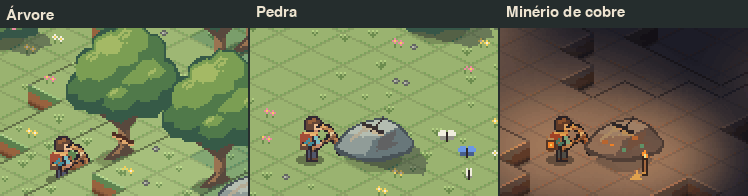</td>
    <td width="36%">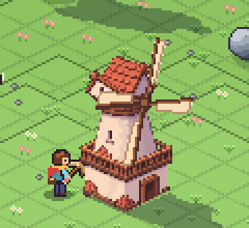</td>
  </tr>
</table>

**Sobreviver ao dia e à noite.** O jogo passa por dia, tarde e noite. A fogueira assa carne e peixe, que curam, e serve para dormir até a manhã. Comida crua tira vida. A horta dá cenoura, nabo e abóbora, e a vara de pesca abre um minigame com doze peixes de rio e de mar, como o lambari, o tucunaré e o pirarucu.

<table>
  <tr>
    <td width="50%">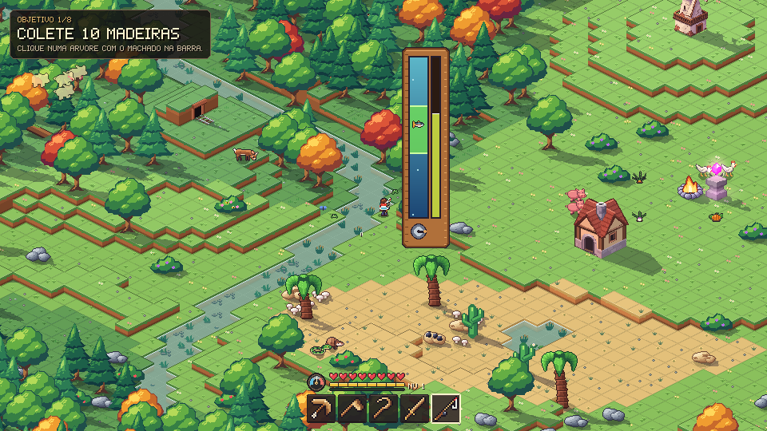</td>
    <td width="50%">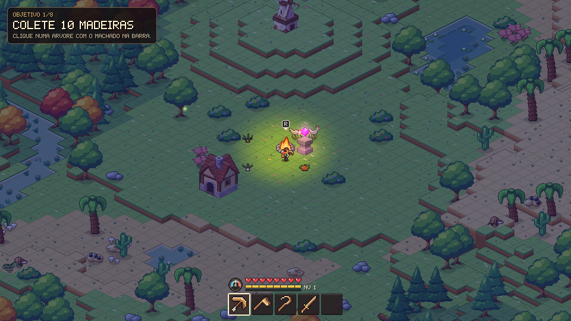</td>
  </tr>
</table>

**Encarar as criaturas.** Cada criatura tem um jeito próprio. O cervo só reage se for atacado, a aranha gigante salta no escuro e o sandworm sai da areia quando ouve seus passos. No mar, o tubarão arrasta quem nada. Na mina, um monstro dorme ao lado dos veios de minério. As criaturas que atacam avisam antes, para dar tempo de desviar.

<table>
  <tr>
    <td width="33%">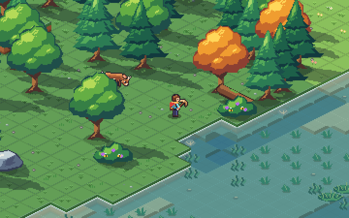</td>
    <td width="33%">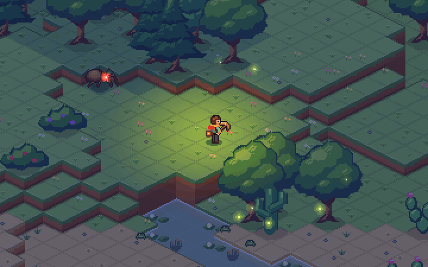</td>
    <td width="33%">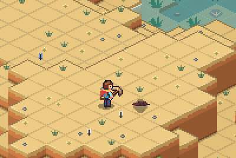</td>
  </tr>
  <tr>
    <td colspan="2">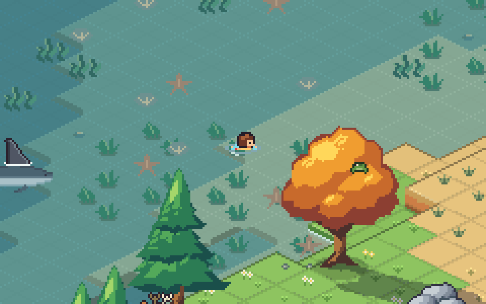</td>
    <td>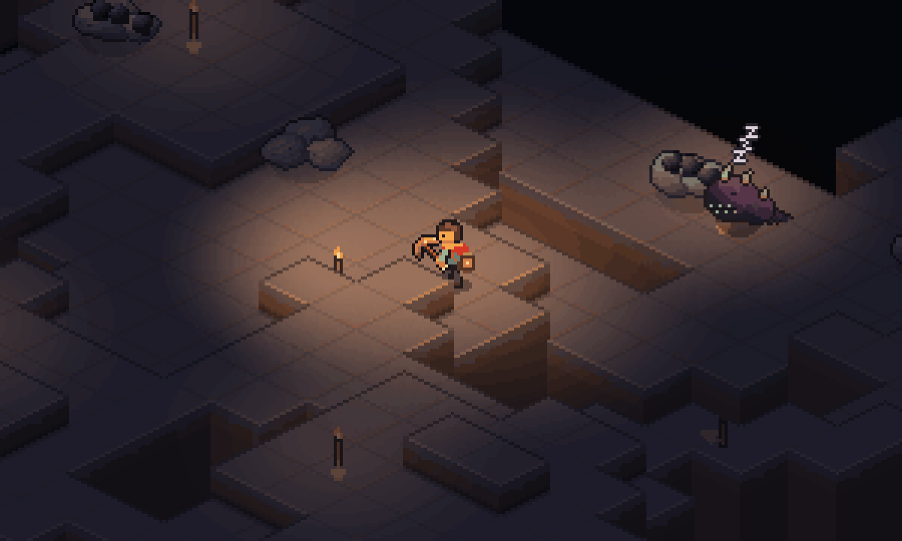</td>
  </tr>
</table>

**Atravessar o mar e vencer o Guardião.** O cais consertado abre a carta náutica, e o barco leva à outra ilha. Lá, num círculo de menires, dorme o Guardião de Pedra. Ele soca, salta e arremessa pedras, e só pode ser ferido depois de cada ataque.

<p align="center">
  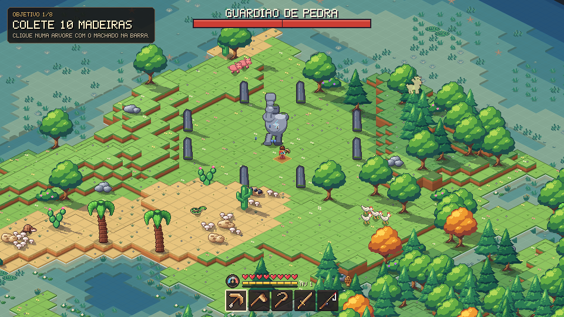
</p>

### Como uma partida avança

Uma linha de oito objetivos, no canto da tela, guia o jogador da primeira madeira até o Guardião.

<p align="center">
  
</p>

## Um mundo diferente a cada seed

As ilhas não são desenhadas à mão. Elas nascem do **ruído de Perlin**, uma técnica que conhecemos pelo jogo ISO-CORE. O ruído dá a cada ponto do mapa um número entre 0 e 1, e pontos vizinhos recebem números parecidos. Por isso ele parece um relevo natural, sem saltos.

<p align="center">
  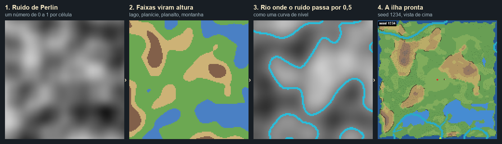
</p>

1. **Um ruído para cada coisa.** Um campo decide a altura, outro a umidade, outro onde nascem as árvores. Cada um mistura uma camada larga, que forma as montanhas, com camadas menores, que dão os detalhes.
2. **Faixas viram terreno.** Valores baixos viram lagos, os médios planícies e planaltos, e os altos montanhas. Na umidade, as faixas separam deserto, campina e floresta.
3. **Os rios seguem uma curva de nível.** O rio passa onde um ruído fica perto de 0,5. Como o ruído varia suavemente, o rio sai sinuoso, com afluentes. A mina usa o mesmo truque: os corredores ficam onde o ruído está entre 0,45 e 0,55.
4. **Regras deixam a ilha jogável.** A base fica sempre numa clareira plana no centro. Rampas garantem que toda a terra seja alcançável, e os lagos têm um tamanho máximo. Conferimos essas regras num levantamento com 150 seeds sorteadas.

O ruído é calculado uma vez, quando a ilha nasce, e não a cada quadro. A seed embaralha a tabela do ruído, então a mesma seed sempre dá a mesma ilha. Digite uma seed em **Novo jogo** para revisitar uma ilha, ou deixe o campo vazio para descobrir outra.

<p align="center">
  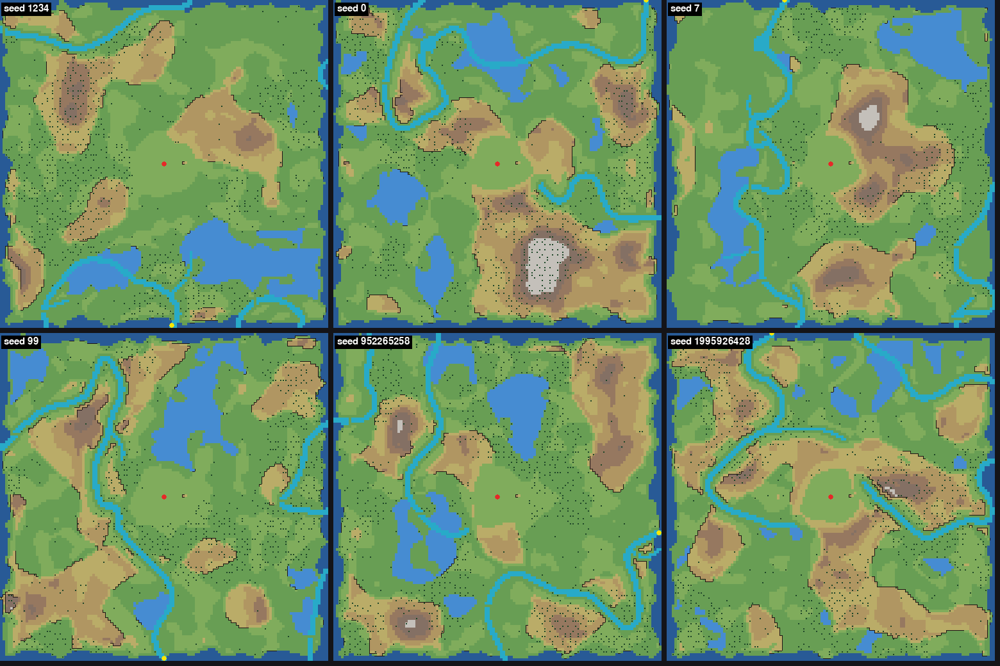
</p>


### Como o código está organizado

- `src/spawnbound/domain`: as regras do jogo, sem nada de tela, como o mundo, a geração por ruído, as criaturas e a fabricação.
- `src/spawnbound`: a aplicação, o desenho, a interface, os menus e o som. O módulo `src/spawnbound/savegame.py` grava e carrega as partidas.
- `dependencias/PPlay`: a cópia do Power PPlay usada pelo jogo.
- `assets`: sprites, imagens e áudio.
- `tests`: os testes automáticos. Rode com `RUN_TESTS.bat` ou `python -m unittest discover -s tests`.

## Documentação

| Documento | O que você encontra | Versões |
| --- | --- | --- |
| **Game Design Document (GDD)** | As decisões de design da dupla, o ciclo de sobrevivência, a progressão entre as ilhas e o que mudou durante o desenvolvimento. | [PDF ilustrado](documentos/GDD-SpawnBound.pdf) · [Markdown](documentos/GDD-SpawnBound.md) |
| **Detalhamento dos Game Objects** | Catálogo de personagens, recursos, construções e eventos da versão final, com seus estados, ações, atributos e relações no mundo. | [PDF](documentos/Game-Objects-SpawnBound.pdf) · [Markdown](documentos/Game-Objects-SpawnBound.md) |
| **Decisões técnicas** | Como a dupla usou o PPlay, o pygame e o código próprio em Python para desenhar a ilha e definir as regras do jogo. | [PPlay, pygame e Python no SpawnBound](decisoes.md) |

## Inspirações

O SpawnBound tem identidade própria, mas aprendeu com vários jogos:

- **ISO-CORE:** o visual isométrico e a geração do terreno por ruído.
- **Stardew Valley:** a pesca, a lavoura, a fornalha e o barco consertado para chegar a outra ilha.
- **Forager:** a coleta direta no cenário e as ilhas como etapas.
- **Minecraft:** as ferramentas em níveis de material e os esqueletos à noite.
- **Sun Haven:** as minas como um lugar à parte.
- **Don't Starve:** o dia, a tarde e a noite, e a fogueira como abrigo.
- **The Legend of Zelda:** os corações e o coração a mais ao vencer o chefe.

## Autores e créditos

Feito por **[João Vitor Battigaglia Fernandes](https://github.com/jotave-br)** e **[Bruno Vicente Dias](https://github.com/bvctdias)** como projeto final de disciplina.

- **Power PPlay 2.0**, do IC-UFF, sob a licença MIT. A licença acompanha o código em `dependencias/PPlay/LICENSE.Power-PPlay.txt`.
- **pygame-ce**, a biblioteca sobre a qual o PPlay funciona.
- **Gravações de áudio** de terceiros, sob licenças Creative Commons. [Autores, adaptações e licenças dos áudios](assets/audio/CREDITOS.md).
