# SpawnBound — Game Design Document

Bruno Vicente Dias

João Vitor Battigaglia Fernandes

*Versão atualizada em 25/11/2026 para descrever o jogo entregue.*

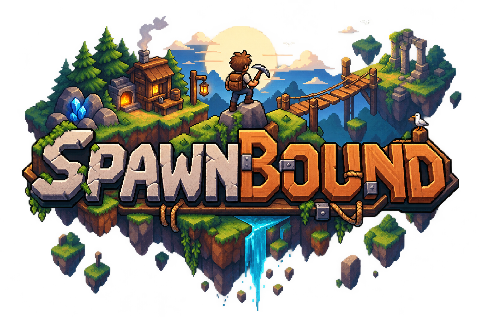

*Figura 1 — Arte de capa gerada por IA.*

## High Concept

Jogo de **exploração, sobrevivência e construção em pixel art isométrica 2D**, feito em Python com o **Power PPlay 2.0**. O jogador desperta sozinho numa ilha gerada a partir de uma *seed*, com uma picareta, um machado, uma foice e uma espada de madeira. Ele coleta recursos e fabrica estações, móveis e ferramentas melhores. Também cozinha, planta, pesca e enfrenta as criaturas da ilha, principalmente à noite. Para avançar, conserta o cais em ruínas na praia e navega até a ilha vizinha, onde o **Guardião de Pedra** dorme num círculo de menires.

O diferencial está na construção do mundo. Relevo, rios, lagos, florestas, desertos e a mina nascem de campos de ruído a cada nova *seed*, e a mesma *seed* sempre gera a mesma ilha. O avanço não é comprado com moedas. O jogador conquista cada passo com material que extraiu, uma ferramenta melhor ou uma estrutura restaurada. O ciclo resultante é curto e legível: **coletar → fabricar → melhorar → atravessar**.

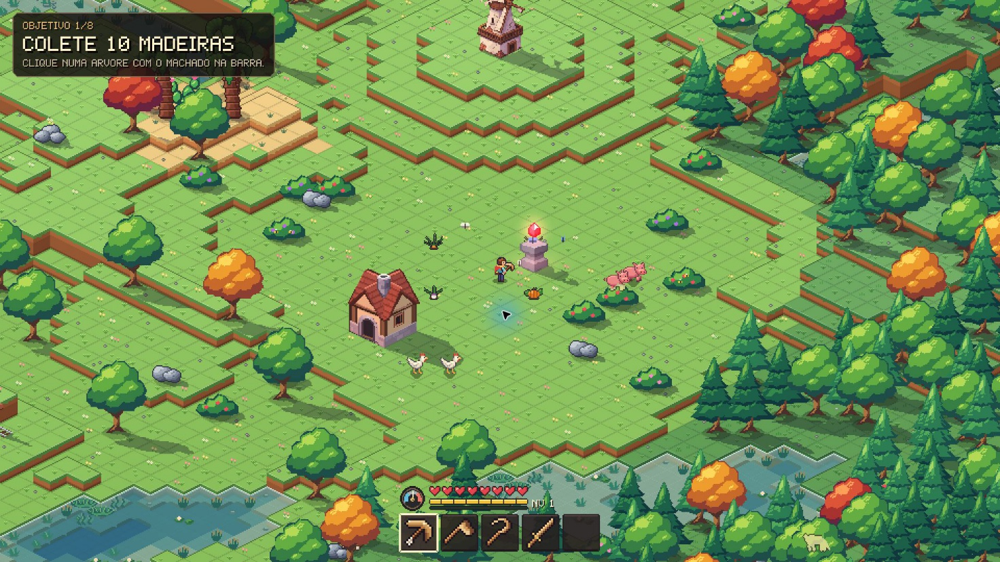

*Figura 2 — Visão geral do jogo na ilha principal.*

## Premissa e enredo

O mundo se partiu em ilhas. O protagonista desperta sozinho na clareira central da ilha principal, entre uma casa vazia e uma pedra de viagem com o cristal aceso. Ninguém explica o que aconteceu, e a ilha conta a história pelo cenário. Um moinho em ruínas no morro, um cais quebrado na praia, uma horta abandonada perto da clareira e menires antigos na ilha vizinha mostram que alguém viveu ali antes.

Para sobreviver, o jogador junta madeira e pedra, desce à mina atrás de carvão e minério, monta uma fogueira e assa o que caçou ou pescou. Para seguir adiante, ele conserta o cais e o barco, navega até a outra ilha e acorda o Guardião de Pedra. Vencê-lo encerra a jornada desta versão com o painel **"Fim da jornada"**, mas o jogo continua aberto para explorar.

O GDD original previa sobreviventes que dariam tarefas e revelariam a história do mundo. Nesta versão, a narrativa é ambiental e a linha de objetivos guia o jogador. Os sobreviventes continuam como ideia para o futuro.

## O mundo

### Ilhas geradas por seed

Cada partida tem duas ilhas, cada uma um espaço próprio, com mapa, fauna, mar e mina.

- **Ilha principal:** 128 × 128 células, com 16 células de oceano em cada lado. Tem a casa, o moinho em ruínas, a horta abandonada, o cais e a primeira pedra de viagem.

- **Ilha do barco:** 96 × 96 células, alcançada pelo cais. Tem mina, fauna, pedra de viagem e a arena do Guardião de Pedra, mas não tem casa nem moinho.

A geração usa campos de ruído (Perlin) em camadas:

- **Relevo:** um perfil de altura cria baixadas, planícies, planaltos e montanhas de até 7 níveis. A costa desce até o mar e os lagos ocupam as baixadas abaixo do nível do mar.

- **Rios:** uma faixa de ruído traça rios sinuosos com afluentes, que descem até o mar e formam a foz.

- **Acesso:** penhascos aparecem em zonas próprias, e rampas garantem que toda a terra seja alcançável.

- **Base:** a clareira da base fica sempre plana, no centro, com o morro do moinho logo acima.

O menu aceita uma *seed* digitada. Com o campo vazio, o jogo sorteia uma nova.

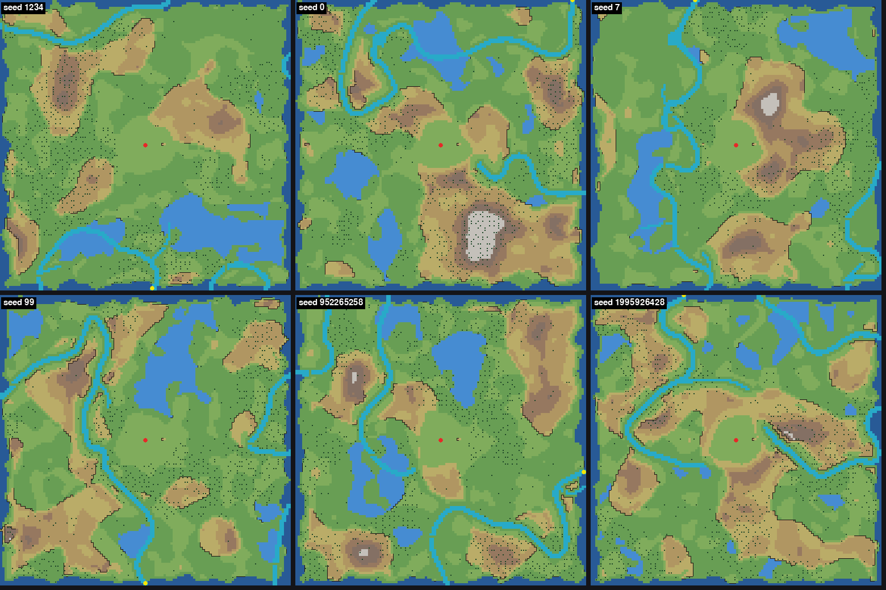

*Figura 3 — Ilhas vistas de cima. Mapas de relevo gerados por seed, com rios e lagos.*

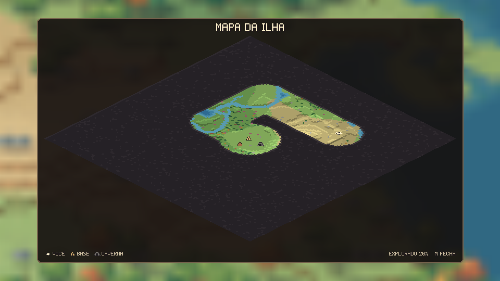

*Continuação da figura 3 — Mapa da ilha aberto com a tecla M.*

### Biomas

| **Bioma** | **Paisagem**                                                                 | **Recursos e vida**                                                            |
|-----------|------------------------------------------------------------------------------|--------------------------------------------------------------------------------|
| Floresta  | Pinheiros, árvores largas e de outono em massas que deixam espaço para andar | Madeira, cogumelos pardos, a morchella rara, cervos e aranhas gigantes à noite |
| Campina   | Árvores isoladas, flores, arbustos de frutas                                 | Frutas, galinhas, porcos, borboletas e abelhas                                 |
| Deserto   | Areia, cactos e palmeiras em três tamanhos                                   | Cogumelos brancos, carvão, cobras, tatus e o sandworm                          |

A água tem fundo visível, fica mais escura com a profundidade e forma espuma nas margens. Os lagos têm juncos, aguapés e cardumes que se escondem na vegetação. Sapos ficam nas margens e vaga-lumes aparecem na floresta ao entardecer.

### A mina

Cada ilha tem uma mina, num espaço próprio, com a entrada fora da base e sempre visível. Dentro, plataformas de pedra em vários níveis ficam no escuro. A lanterna do personagem ilumina o caminho, e tochas com setas acendem por proximidade para indicar a saída. Carvão, cobre e quartzo ficam mais comuns quanto mais longe da entrada. Monstros dormem ao lado dos veios, à razão de um a cada três veios.

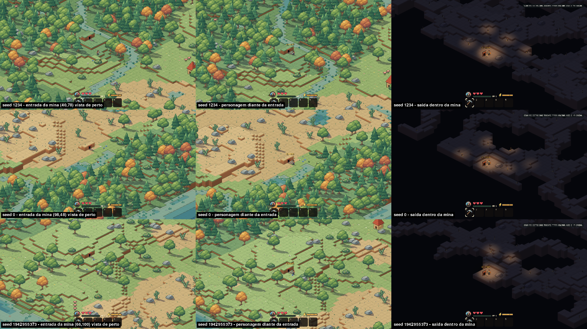

*Figura 4 — Entrada e interior da mina.*

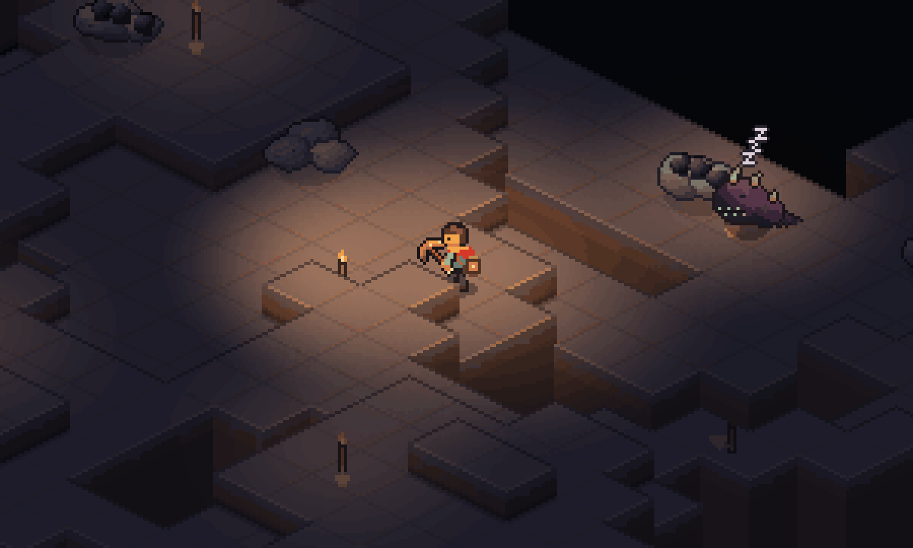

*Continuação da figura 4 — Monstro da mina.*

### A casa

A casa da clareira é um abrigo de 10 × 10 células de piso, iluminado pelas tochas e cercado de vazio preto. Ela começa vazia. Tudo o que fica dentro dela é fabricado e colocado pelo jogador: cama, baú, tochas, bancada, fornalha e composteira. A roda do mouse gira o móvel antes de colocá-lo, e segurar o clique sobre ele por 0,8 s o recolhe para a mochila com o que ele guardava.

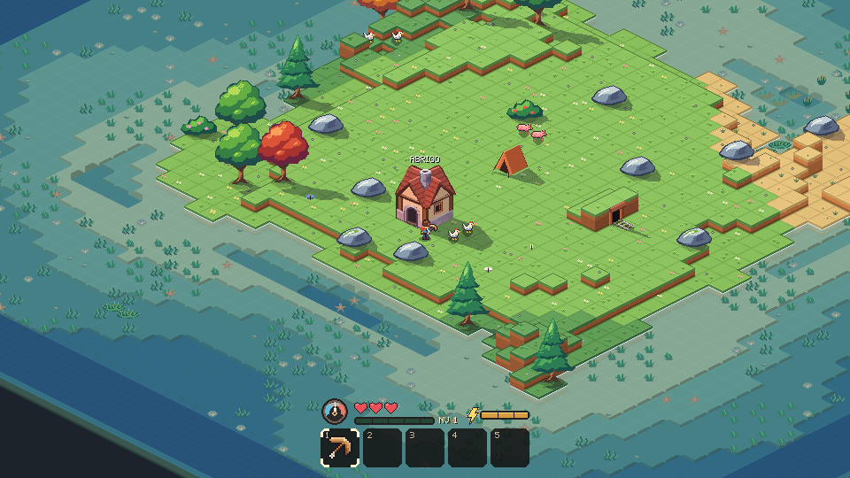

*Figura 5 — Vista externa da casa na clareira.*

### Dia, tarde e noite

O exterior passa por dia, tarde e noite, 30 segundos cada, num ciclo de 90 segundos. A luz e as sombras mudam aos poucos. À noite, a lanterna acompanha o personagem e surgem esqueletos arqueiros e aranhas gigantes. A cama e a fogueira permitem dormir até a manhã.

## Gameplay

### Ciclo central

O jogador explora, coleta e ganha XP. Com o que juntou, fabrica estações e ferramentas melhores, que abrem recursos mais difíceis: o cobre pede a picareta de pedra, e o quartzo, a de cobre. Ao mesmo tempo, administra vida e energia comendo, cozinhando e dormindo. Com material suficiente, conserta o cais, atravessa até a outra ilha e enfrenta o Guardião.

**explorar → coletar → fabricar → melhorar ferramentas → sobreviver à noite → consertar o cais → atravessar → enfrentar o Guardião**

*Figura 6 — Fluxograma de progressão.*

### Coleta e ferramentas

O jogador clica num recurso para andar até ele e golpear. Segurar o botão continua coletando. Cada golpe faz o recurso tremer e soltar lascas, o desgaste aparece em quatro estágios, e a árvore tomba ao cair. A coleta gasta energia e dá XP.

As quatro ferramentas começam de madeira e sobem para pedra, cobre e quartzo. A tecla **U** melhora a ferramenta selecionada, e a bancada mostra as mesmas melhorias.

| **Melhoria**    | **Custo**              |
|-----------------|------------------------|
| Madeira → pedra | 2 madeiras e 3 pedras  |
| Pedra → cobre   | 2 pedras e 1 cobre     |
| Cobre → quartzo | 1 quartzo e 2 madeiras |

| **Ferramenta** | **Uso**                       | **Ganho por nível (madeira, pedra, cobre, quartzo)**                        |
|----------------|-------------------------------|-----------------------------------------------------------------------------|
| Picareta       | Pedras, carvão e minérios     | Força 3, 4, 6 e 8. O cobre pede a picareta de pedra e o quartzo, a de cobre |
| Machado        | Árvores e troncos caídos      | Força 3, 4, 6 e 8. Sem o machado, a madeira demora três vezes mais          |
| Espada         | Caça e combate                | Dano 2, 3, 4 e 5. As outras ferramentas e a mão tiram 1                     |
| Foice          | Preparar a terra para plantar | A de madeira prepara o solo em duas passadas, as outras em uma              |

A **vara de pesca** sai da bancada com 1 madeira e 3 fios de teia.

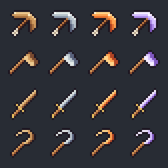

*Figura 7 — Os quatro níveis de ferramenta.*

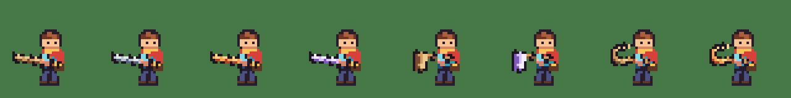

*Continuação da figura 7 — Personagem com as ferramentas equipadas.*

### Fabricação e estações

A mochila tem uma **bancada** sempre à mão, que fabrica na hora. As outras estações são colocadas no mundo e produzem com o tempo. Cada uma guarda o próprio lote, e o produto pronto aparece num balão clicável.

| **Item**      | **Custo**                  | **Para que serve**                                                                     |
|---------------|----------------------------|----------------------------------------------------------------------------------------|
| Bancada       | 6 madeiras e 2 pedras      | Uma bancada colocada abre as mesmas receitas da bancada da mochila                     |
| Tocha         | 2 madeiras                 | Luz na casa e no mundo                                                                 |
| Cama          | 6 madeiras e 1 couro       | Cochilo de dia, sono até a manhã à tarde e à noite                                     |
| Baú           | 5 madeiras                 | Guarda mais 32 pilhas                                                                  |
| Fornalha      | 8 pedras e 2 madeiras      | Funde 6 cobres e 3 carvões numa barra de cobre, que ainda não entra em outras receitas |
| Composteira   | 4 madeiras e 2 frutas      | Transforma uma colheita na semente correspondente                                      |
| Fogueira      | 3 carvões e 5 pedras       | Cozinha até 4 tipos em fila, ilumina e serve de descanso                               |
| Vara de pesca | 1 madeira e 3 fios de teia | Pesca em rios, lagos e no mar                                                          |

A mochila tem 5 × 3 espaços e divide os itens com a barra rápida de cinco espaços. Os itens comuns empilham até 64. Abrir a mochila ou o baú pausa o jogo e desfoca o cenário. Na mochila, os itens são arrastados, trocados com a barra pelo número ou transferidos um a um com o botão direito.

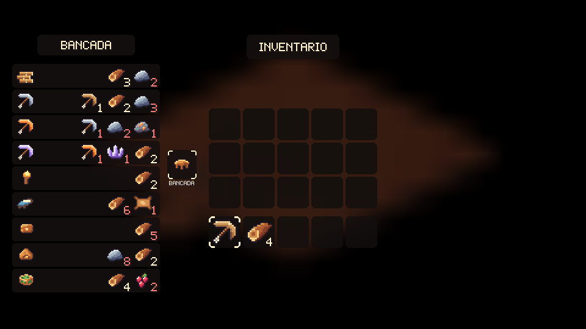

*Figura 8 — Fabricação na bancada aberta.*

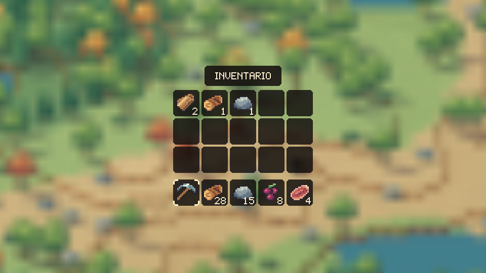

*Continuação da figura 8 — Mochila.*

### Sobrevivência: vida, energia e descanso

- **Vida:** 8 corações. Vencer o Guardião acrescenta um nono coração.

- **Energia:** 100 pontos, gastos ao coletar, golpear e lutar. Sem energia, o personagem não consegue agir até comer ou descansar.

- **Comida:** a tecla **Q** come.

  - Frutas, cogumelos e colheitas só devolvem energia.

  - Carne e peixe assados devolvem muito mais energia e curam 1 coração.

  - Crus, tiram 1 coração. O jogo recusa a carne crua quando ela custaria o último coração.

- **Descanso:** a tecla **R**, perto da cama ou da fogueira.

  - De dia, a cama dá um cochilo que devolve 15% da energia.

  - À tarde e à noite, a cama e a fogueira fazem dormir até a manhã, com metade da energia e 2 corações de volta.

- **Derrota:** ao perder o último coração, o jogador volta à clareira da ilha principal com vida e energia cheias, sem perder os itens. O tubarão que arrasta o nadador para o fundo tem o mesmo efeito.

### Cozinha

A fogueira assa até quatro tipos de alimento em fila: carne de porco e de galinha, carne de cervo, carne de cobra e os doze peixes. Um peixe só aparece no painel quando está na mochila.

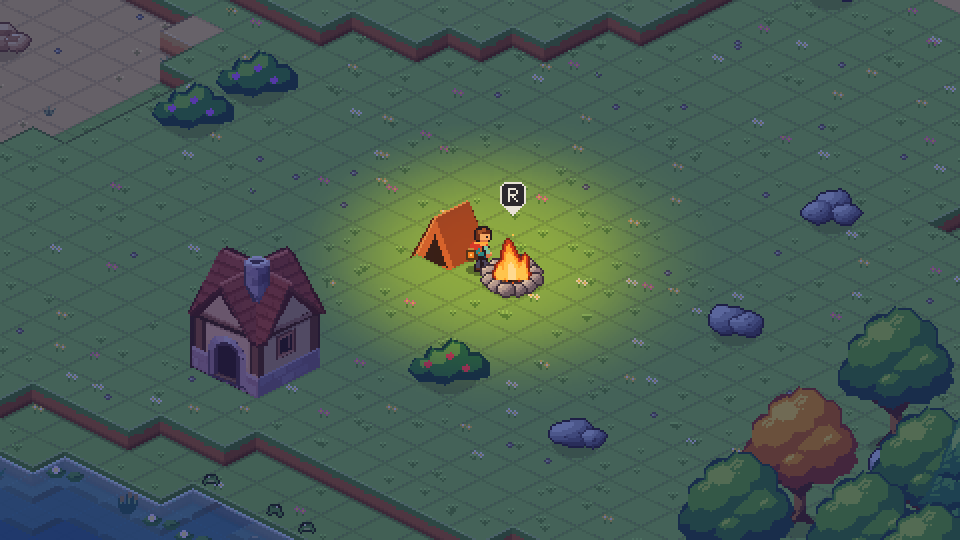

*Figura 9 — Fogueira.*

### Fazenda

Com a foice, o clique direito revolve a grama e deixa o solo pronto. Com uma semente na mão, o clique direito planta, e numa planta madura colhe.

- As plantas crescem em quatro estágios desenhados no jogo, com balanço ao vento.

- A cenoura leva 2 dias, o nabo 3 e a abóbora 5. O tempo continua correndo enquanto o jogador dorme.

- Não é preciso regar.

- A horta abandonada perto da clareira já tem plantas e dá as primeiras colheitas. A composteira transforma essas colheitas em sementes.  

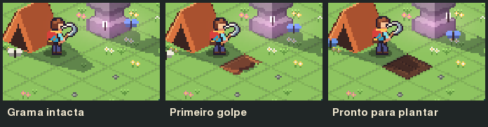

*Figura 10 — Etapas de preparo do solo.*

### Pesca

Com a vara equipada:

1.  O jogador segura o clique sobre a água para encher a força e solta para lançar a boia, a até 6 células.

2.  A mordida vem em alguns segundos, mais cedo perto dos cardumes.

3.  Um clique logo depois do **"!"** fisga o peixe.

4.  Começa o minigame: o mundo para, a barra verde sobe enquanto um botão do mouse fica apertado e desce ao soltar. Manter o peixe dentro da barra enche o medidor.

| **Água**                 | **Peixes, do mais fácil ao mais difícil**            |
|--------------------------|------------------------------------------------------|
| Rios e lagos (água doce) | Lambari, tilápia, bagre, traíra, tucunaré e pirarucu |
| Mar (água salgada)       | Sardinha, tainha, baiacu, robalo, garoupa e atum     |

Cada peixe tem dificuldade, jeito de nadar e hora de morder. O bagre e o robalo mordem à noite, e a tilápia, a tainha, o tucunaré e o atum, de dia.

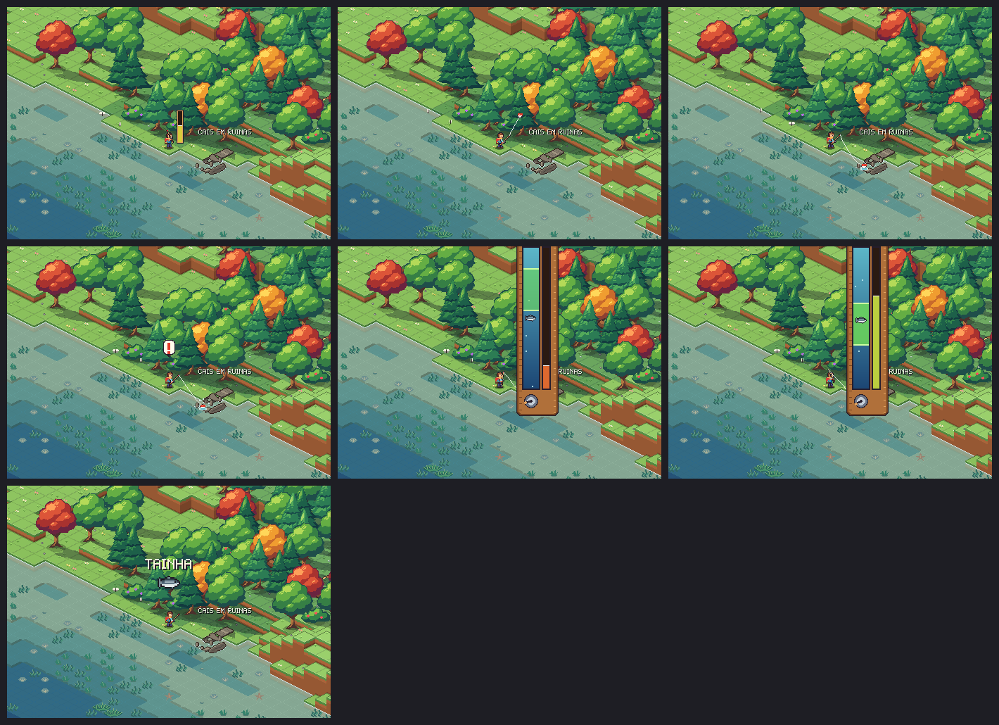

*Figura 11 — Pesca e minigame.*

### Criaturas e combate

O jogador ataca com o clique, de preferência com a espada. As criaturas ficam vermelhas ao receber dano. Os pacíficos feridos fogem. Os agressivos avisam antes de cada golpe, para que o jogador possa se afastar ou pular.

| **Criatura**          | **Onde e quando**                       | **Comportamento**                                                                                  | **O que deixa**                             |
|-----------------------|-----------------------------------------|----------------------------------------------------------------------------------------------------|---------------------------------------------|
| Galinha e porco       | Campina e floresta                      | Pacíficos. Quando um é atingido, o bando foge                                                      | Carne                                       |
| Cervo                 | Floresta                                | Pacífico até ser atacado. Responde com coice e com uma investida que tira 2 corações               | Carne de cervo e couro                      |
| Cobra                 | Deserto                                 | Avisa antes do bote e fica exposta logo depois dele                                                | Carne de cobra                              |
| Tatu                  | Deserto                                 | Pacífico. Golpeado, vira bola e o golpe não entra                                                  | Carne e couro                               |
| Esqueleto arqueiro    | À noite, ao ar livre                    | Atira flechas de longe                                                                             | —                                           |
| Aranha gigante        | Floresta, à noite                       | Salto e mordida avisados. Os olhos brilham no escuro, e o salto tira 2 corações                    | Fio de teia e, às vezes, glândula de veneno |
| Tubarão               | Mar aberto                              | Morde quem nada e não pode ser ferido. Depois de três mordidas, arrasta o nadador para o fundo     | —                                           |
| Sandworm (mini chefe) | Uma ou duas tocas fixas em cada deserto | Emerge com os passos na areia e se enterra quando o jogador fica parado. Morto, não volta          | Casco de sandworm                           |
| Monstro da mina       | Dormindo ao lado dos veios              | Acorda com o jogador perto ou com um golpe no veio. Morde e atropela, e o atropelo tira 2 corações | —                                           |

### O Guardião de Pedra

O único chefe do jogo é um golem de pedra que dorme no centro de um círculo de oito menires. A arena é uma planície gerada em toda ilha do barco e sempre alcançável a partir do cais. Ele desperta quando o jogador se aproxima ou o golpeia.

| **Golpe**                   | **Aviso**                                                       | **Dano**                           | **Abertura**               |
|-----------------------------|-----------------------------------------------------------------|------------------------------------|----------------------------|
| Soco, de perto              | As células em volta do jogador ficam vermelhas e um "!" aparece | 2 corações                         | O punho fica preso no chão |
| Salto                       | Ele se agacha com os braços erguidos                            | 2 corações se cair em cima         | Enquanto se levanta        |
| Onda de choque, ao cair     | Um anel de poeira se espalha                                    | 1 coração. Pular com Espaço desvia | —                          |
| Pedra arremessada, de longe | Uma sombra cresce onde a pedra vai cair                         | 2 corações                         | —                          |

Fora das aberturas, a pedra desvia a lâmina e o golpe não tira vida. Abaixo da metade da vida, as rachaduras e os olhos dele queimam em laranja. Os avisos e as aberturas ficam mais curtos, ele lança três pedras de uma vez e o salto solta dois anéis. Se o jogador fugir para longe, o Guardião volta ao centro e dorme de novo, sem recuperar as feridas. Vencido, ele não volta e dá um coração a mais, 3 quartzos e 4 cobres.

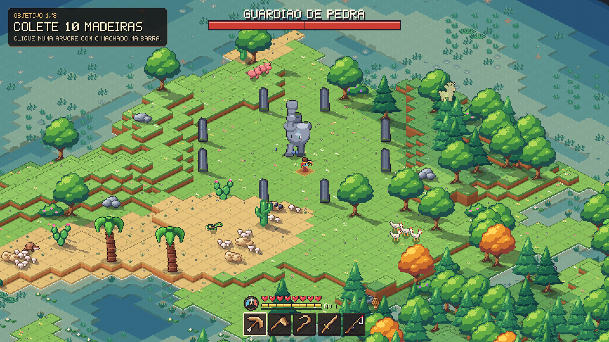

*Figura 12 — O Guardião de Pedra. Luta com a barra de vida.*

### Travessia: cais, barco e pedras de viagem

- **O cais em ruínas** fica na praia da ilha principal. Clicar nele abre um painel com o que falta. Com 15 madeiras e 5 pedras, a tecla **E** conserta o cais e o barco.

- **A carta náutica** abre ao usar E no cais consertado. Ela mostra o contorno das ilhas já visitadas e um "?" nas desconhecidas. Ao escolher uma ilha, a tela escurece durante a travessia enquanto a ilha nova é gerada, e o jogador chega à praia dela.

- **As pedras de viagem** têm uma cor de cristal por ilha. A da ilha principal começa ativa, e as outras precisam ser visitadas e ativadas com E. Depois disso, E numa pedra leva à próxima pedra ativa, mesmo em outra ilha.

- **O moinho em ruínas** no morro da base é consertado com 10 madeiras e 5 pedras, e as pás voltam a girar.

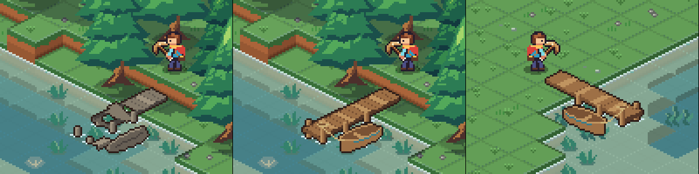

*Figura 13 — Reparo do cais.*

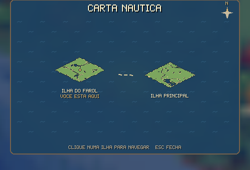

*Continuação da figura 13 — Carta náutica.*

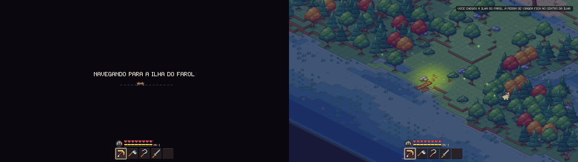

*Continuação da figura 13 — Travessia e chegada à outra ilha.*

### Progressão: objetivos, XP e final

Uma linha de oito objetivos, no canto superior esquerdo, conduz o jogador do começo ao fim:

1.  Colete 10 madeiras.

2.  Melhore uma ferramenta para pedra.

3.  Junte 3 carvões na mina.

4.  Monte uma fogueira.

5.  Asse uma carne na fogueira.

6.  Conserte o cais.

7.  Navegue até outra ilha.

8.  Derrote o Guardião de Pedra.

O painel fica verde por alguns segundos a cada objetivo cumprido. Dicas de primeira vez aparecem acima dos corações nos momentos certos, por exemplo no primeiro coração perdido, na primeira noite, ao entrar na mina e perto da arena do Guardião. Quando o Guardião cai, o painel "Fim da jornada" mostra o tempo de jogo, as ilhas visitadas e os corações, e o jogador pode continuar explorando.

Coletar, colher e vencer criaturas dá XP. O nível aparece no HUD, e cada nível pede 50 XP a mais que o anterior, começando em 100. Nesta versão, o nível ainda não desbloqueia receitas nem habilidades. A progressão vem dos materiais, das ferramentas e das estruturas restauradas.

## Interface do usuário

### HUD

A interface continua mínima para preservar a leitura do cenário isométrico.

- **Centro inferior:** 8 corações; a barra amarela de energia logo abaixo; uma linha verde de nível com "NV" e o número; um mostrador de temperatura provisório, ainda sem efeito no jogo; e a barra rápida com cinco espaços.

- **Canto superior esquerdo:** o objetivo atual.

- **Canto superior direito:** avisos de perigo e o motivo de uma ação não acontecer, como "Energia insuficiente".

- **Centro superior:** o nome e a vida do Guardião durante a luta.

- **Sobre o mundo:** personagem e criaturas escondidos atrás de árvores e construções aparecem em silhueta.

O mapa da ilha abre na tecla **M** e se revela conforme o jogador explora.

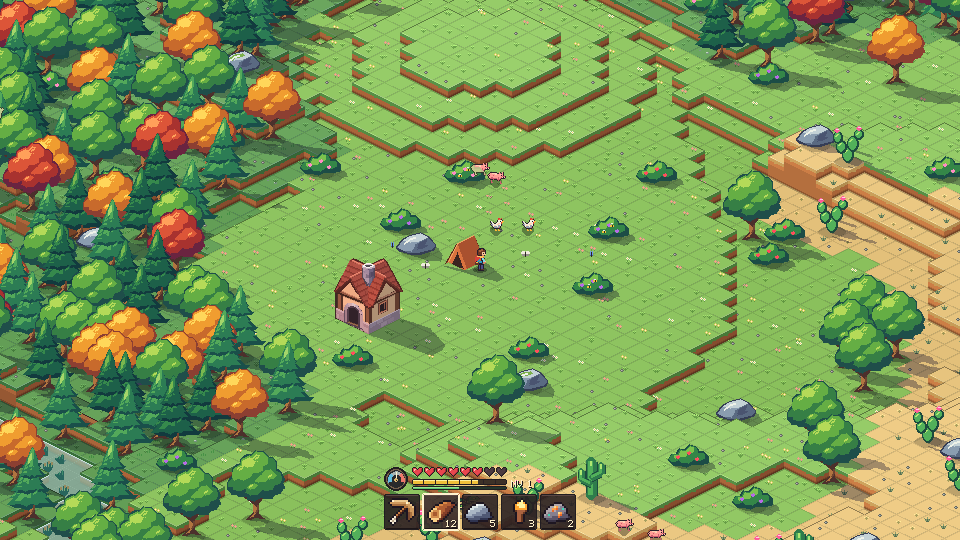

*Figura 14 — Elementos da interface em jogo.*

### Controles

O GDD original previa WASD como movimento principal. Em agosto, os autores trocaram para o clique com rota automática, que funciona melhor na visão isométrica e aproveita o *pathfinding* (A\*) dos animais. O clique numa célula leva o personagem ao ponto alcançável mais próximo, e cada degrau de um nível no caminho vira um pulo.

| **Comando**           | **Ação**                                                                                                             |
|-----------------------|----------------------------------------------------------------------------------------------------------------------|
| Clique esquerdo       | Andar até o ponto, coletar, atacar ou colocar um móvel. Segurar continua coletando. Segurar sobre um móvel o recolhe |
| Clique direito        | Comer, arar com a foice, plantar ou colher                                                                           |
| Roda do mouse / 1 a 5 | Selecionar o espaço da barra. A roda também gira o móvel durante a colocação                                         |
| Espaço                | Pular                                                                                                                |
| E                     | Interagir com portas, baús, estações, pedras de viagem, moinho e cais                                                |
| I ou Tab              | Abrir a mochila e a fabricação                                                                                       |
| M                     | Abrir o mapa da ilha                                                                                                 |
| Q                     | Comer                                                                                                                |
| R                     | Descansar perto da cama ou da fogueira                                                                               |
| U                     | Melhorar a ferramenta selecionada                                                                                    |
| G                     | Recolher um móvel                                                                                                    |
| C                     | Usar o kit de ponte, que só existe no mapa de protótipo                                                              |
| Esc                   | Pausar ou fechar um painel                                                                                           |
| F ou F11              | Alternar tela cheia e janela                                                                                         |

**Pesca:** segurar o clique sobre a água e soltar para lançar, clicar quando aparecer o "!" e, no minigame, segurar para subir a barra verde e soltar para descer.

A página **Controles**, no menu de pausa, mostra os controles dentro do jogo.

### Menus e saves

- **Menu inicial:** fica sobre uma cena viva da ilha que passa do dia à noite. Tem Novo jogo (com *seed* opcional), Continuar (quando há save), Carregar jogo e Sair.

- **Pausa:** a tecla Esc abre Continuar, Salvar jogo, Controles, Menu principal e Sair do jogo.

- **Saves:** há três espaços. O jogo confirma antes de sobrescrever outra partida e pergunta antes de sair com progresso não salvo, também pelo X da janela. As partidas ficam na pasta saves, ao lado do jogo.

- **Tela:** o jogo abre em tela cheia.

## Áudio e música

- **Música:** uma faixa original no menu inicial, com oito compassos de cordas dedilhadas e baixo. Durante a partida, inclusive na pausa, ficam só os efeitos.

- **Efeitos:** acompanham a animação. A árvore estala no corte e bate no chão ao cair, a pedra solta fragmentos, o item coletado toca ao chegar ao personagem e o golpe e o dano têm som próprio. A fisgada respinga, a subida de nível tem um sinal e os menus e a mochila respondem aos cliques.

- **Passos e nado:** gravações diferentes para grama, areia, madeira e pedra, e braçadas na água.

- **Ambiente:** muda conforme o lugar. A floresta tem pássaros e folhagem, o deserto e a campina têm vento, a noite tem grilos, a mina tem goteiras e a casa tem um som próprio. As ondas do mar e o crepitar da fogueira aumentam com a proximidade.

- **Volume:** música e efeitos ficam fixos em torno de 20%.

## Arte e direção visual

O visual do SpawnBound é pixel art isométrica nativa. Cada célula tem 32 × 16 pixels e cada nível de altura sobe 10 pixels. A imagem é ampliada por números inteiros para não deformar os pixels. O personagem é pequeno diante de árvores, rochas e construções grandes, e a câmera mostra bastante da ilha.

- **Desenho:** os sprites são desenhados por geradores em Python a partir das imagens de referência dos autores e podem ser refeitos por código. O personagem tem seis ações em oito direções, além do nado e da pose de dano.

- **Leitura dos golpes:** o recurso treme e solta lascas, o desgaste aparece em quatro estágios e a árvore tomba. A tela treme quando o Guardião cai do salto, quando o punho dele crava no chão e quando o personagem leva dano.

- **Luz:** sombras projetadas e de contato, luz ambiente que acompanha o ciclo do dia, luz radial da lanterna, das tochas e da fogueira, e vaga-lumes que brilham à noite.

- **Água:** translúcida, mais escura conforme a profundidade, com espuma nas margens e o personagem parcialmente submerso ao nadar.

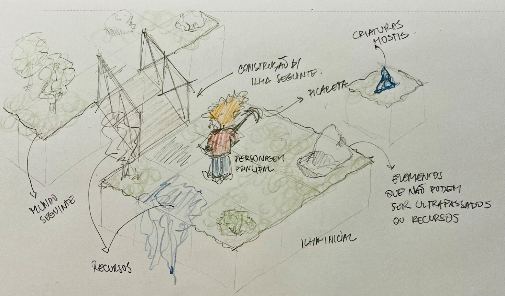

*Figura 15 — Esboço inicial da ambientação feito por Bruno Vicente Dias.*

As principais referências visuais e de mecânica estão em Referências e créditos.

## Tecnologia

- **Linguagem e bibliotecas:** Python 3.13 com pygame-ce 2.5.8 e o **Power PPlay 2.0** (UFF), que acompanha o código com sua licença MIT.

- **O que passa pelo PPlay:** a janela e o laço do jogo, teclado, mouse e ações com nome, imagens, personagem animado, cenas do menu e da partida, botões e barras da interface, esmaecimentos, tremor de tela, partículas, música e efeitos.

- **O que usa o pygame diretamente:** o desenho do terreno e dos objetos parados, o relógio do quadro, a fonte, as colisões do mundo e os temporizadores.

- **Arquitetura:** a lógica do jogo (mundo, geração, regras, criaturas, saves) fica separada da tela e é coberta por 639 testes automáticos.

- **Distribuição:** o executável para Windows vem numa pasta, gerado com o PyInstaller, com lançadores para Windows e macOS.

## Referências e créditos

O SpawnBound tem identidade própria, mas várias mecânicas seguem jogos que admiramos. Esta seção reconhece essas influências.

| **Jogo**                                      | **O que inspirou o SpawnBound**                                                                                                                                                                                                                                                                                                     | **Como o SpawnBound faz**                                                                                                                                                    |
|-----------------------------------------------|-------------------------------------------------------------------------------------------------------------------------------------------------------------------------------------------------------------------------------------------------------------------------------------------------------------------------------------|------------------------------------------------------------------------------------------------------------------------------------------------------------------------------|
| **ISO-CORE**                                  | Referência principal de direção visual: pixel art isométrica, escala do personagem, fazenda, moinho, pedra de teletransporte. Fomos apresentados a tecnica do ruido de perlin pelo proprio isocore.                                                                                                                                 | Relevo por perfil de altura, nível do mar e rios por faixa de ruído, com desenhos próprios feitos por código                                                                 |
| **Stardew Valley**                            | Minigame de pesca com a barra verde e o "!" da fisgada; lavoura que cresce em dias; máquina que transforma colheitas em sementes; fornalha que funde minério com carvão; melhoria de ferramentas por material; mina com minérios mais raros no fundo; cama que passa para o dia seguinte; o barco consertado para chegar a uma ilha | Minigame com desenho próprio, controlado por qualquer botão do mouse; sem regar; composteira no papel de produtora de sementes; cais e barco consertados com madeira e pedra |
| **Forager**                                   | Leitura clara do cenário, recursos espalhados para coletar com o clique e segurar para continuar coletando; ilhas como unidade de progressão; pontes sobre a água                                                                                                                                                                   | A terra nova não é comprada com moedas: o jogador conserta o cais e navega                                                                                                   |
| **Minecraft**                                 | Ferramentas em níveis de material; machado mais rápido na madeira; mochila reorganizada por arraste; esqueletos arqueiros à noite; tochas; cama                                                                                                                                                                                     | Níveis madeira, pedra, cobre e quartzo, e mapa isométrico finito por ilhas                                                                                                   |
| **Sun Haven**                                 | Minas como áreas separadas, com minérios e monstros próprios                                                                                                                                                                                                                                                                        | Uma mina por ilha, num espaço próprio, de um andar, com tochas que indicam a volta, aplicaçao bem menos ambiciosa que sun haven porém foi uma inspiração mesmo assim.        |
| **Don't Starve**                              | Dia, entardecer e noite como três fases; a fogueira como lugar seguro para passar a noite; comida cozida melhor que a crua; mapa revelado pela exploração                                                                                                                                                                           | Carne e peixe crus tiram um coração e assados curam um; dormir na fogueira pula para a manhã                                                                                 |
| **The Legend of Zelda**                       | Vida em corações; um coração a mais ao vencer o chefe; chefes que só podem ser feridos nas aberturas depois de atacar                                                                                                                                                                                                               | O Guardião desvia a espada fora das aberturas e dá o nono coração                                                                                                            |
| **Valheim**                                   | Navegar para alcançar ilhas novas; o chefe como marco de progressão                                                                                                                                                                                                                                                                 | Travessia por carta náutica e Guardião na ilha do barco                                                                                                                      |
| **Raft**                                      | O tubarão que ataca quem nada                                                                                                                                                                                                                                                                                                       | O tubarão não pode ser ferido e arrasta o nadador para o fundo                                                                                                               |
| ***Duna*** (livros de Frank Herbert e filmes) | O verme do deserto atraído pelos passos na areia                                                                                                                                                                                                                                                                                    | O sandworm emerge com os passos e se enterra quando o jogador para                                                                                                           |

### Ferramentas e recursos de terceiros

- **Power PPlay 2.0**, framework da disciplina (UFF), sob licença MIT.

- **pygame-ce**, base do PPlay.

- **Gravações de áudio**: gerado integralmente pelo Codex fornecendo nosso gdd e arquivos do jogo como contexto

- As imagens deste documento marcadas como "gerada por IA" foram produzidas com inteligência artificial, todo o restante são prints de dentro do jogo.

## Mudanças em relação ao GDD original

| **Tema**                      | **GDD original (agosto de 2026)**                          | **Jogo atual (novembro de 2026)**                                                                                                                                                                                                      |
|-------------------------------|------------------------------------------------------------|----------------------------------------------------------------------------------------------------------------------------------------------------------------------------------------------------------------------------------------|
| Ferramentas                   | A picareta como provável única ferramenta                  | Picareta, machado, foice e espada, em quatro níveis, mais a vara de pesca                                                                                                                                                              |
| Movimento                     | WASD em oito direções, com o mouse como opção              | Clique com rota automática. O WASD saiu por ser muito confuso devido a perspectiva;                                                                                                                                                    |
| Vida                          | Três corações                                              | Oito corações, e um a mais ao vencer o Guardião; o jogo estava muito punitivo com apenas 3.                                                                                                                                            |
| Energia                       | Esgotada, sem comida, podia tirar vida                     | Zerada, só impede as ações. A comida crua é que tira vida                                                                                                                                                                              |
| Descanso                      | Recuperava só 15% da energia                               | O cochilo de dia na cama ainda devolve 15%. Dormir à tarde ou à noite na cama ou na fogueira pula para a manhã com metade da energia e 2 corações; ainda é possivel abusar do cochilo na cama para conseguir 100% da energia novamente |
| Níveis                        | Pontos de habilidade desbloqueariam receitas e capacidades | O XP e o nível aparecem, mas ainda não desbloqueiam nada. As receitas ficam abertas desde o começo; não conseguimos implementar um sistema de habilidades que fizesse sentido ou que não deixasse o jogo mais travado                  |
| Travessia                     | Plataformas e pontes fabricadas entre setores              | Cais em ruínas, barco, carta náutica e pedras de viagem. O kit de ponte ficou só no mapa de protótipo                                                                                                                                  |
| Mundo                         | Ilha inicial de bioma fixo e setores desconectados         | Duas ilhas por *seed*, cada uma com floresta, campina e deserto, rios, lagos e mina                                                                                                                                                    |
| Biomas                        | Tundra e taiga, deserto e floresta                         | Floresta, campina e deserto                                                                                                                                                                                                            |
| Sobreviventes e NPCs          | Tarefas, trocas, receitas e história                       | Ainda não existem                                                                                                                                                                                                                      |
| Inimigos                      | Slimes no começo e mais perigo à noite                     | Sem slimes. A noite traz esqueletos arqueiros e aranhas, e há mais oito criaturas com comportamento próprio                                                                                                                            |
| Chefes                        | Um por região, no máximo um no protótipo                   | Um: o Guardião de Pedra localizado na ilha secundaria                                                                                                                                                                                  |
| Minas (ideia adicional)       | Áreas separadas com andares, como no Sun Haven             | Uma mina por ilha, de um andar e relativamente pequena                                                                                                                                                                                 |
| Agricultura (ideia adicional) | Plantar para comer                                         | Implementada, sem regar                                                                                                                                                                                                                |
| HUD                           | Energia, vidas e XP no topo, inventário embaixo            | Corações, energia e nível embaixo, com a barra de cinco espaços. Objetivo, avisos e vida do chefe em cima                                                                                                                              |
| Música                        | Música ambiente por bioma                                  | Música no menu. Na partida, efeitos e sons ambientes por lugar; ainda existem ações sem efeito musical devido a baixa qualidade produzida pela IA                                                                                      |
| Enredo                        | Revelado pelos sobreviventes e pelos vestígios             | Contado pelo cenário e pela linha de objetivos, até o "Fim da jornada"                                                                                                                                                                 |

## Ideias para o futuro

Nada desta seção está no jogo atual.

**Previstas no GDD original e ainda não feitas**

- Sobreviventes com tarefas, trocas e a história do mundo, incluindo o ancião do minigame de xadrez.

- Pontos de habilidade por nível e uma árvore de habilidades lida de um arquivo de dados.

- Novos biomas, como tundra e taiga.

- Um chefe para cada região.

- Minas com vários andares e requisitos para liberar os mais fundos, como no Sun Haven.

- Passagens bloqueadas por criaturas que pedem uma comida específica, como o urso adormecido do Sun Haven.

- Slimes como primeiros inimigos.

- Desafios de travessia baseados em física.

**Surgidas durante o desenvolvimento**

- Navegação livre de barco entre as silhuetas das ilhas, a segunda etapa da travessia.

- Armadura feita com o casco do sandworm, sugestão do Bruno.

- Uso para a glândula de veneno da aranha.

- Ferro, ouro, argila e areia no mundo, para as receitas de fornalha já desenhadas: barras de ferro e de ouro, tijolo, vidro, frasco e pote. Um uso para a barra de cobre.

- Uma função para o moinho consertado.

- Estações do ano e efeito real para o mostrador de temperatura.

- Caravelas no mar, praias e ruínas geradas proceduralmente.

**Descartadas pelos autores**

- Regar as plantas

- Baú de tesouro no minigame de pesca.

- Um oceano contínuo com várias ilhas no mesmo mapa, fazendo uso do ruido de perlin e o barco podendo navegar pelo oceano da mesma forma que o personagem caminha pela ilha;
